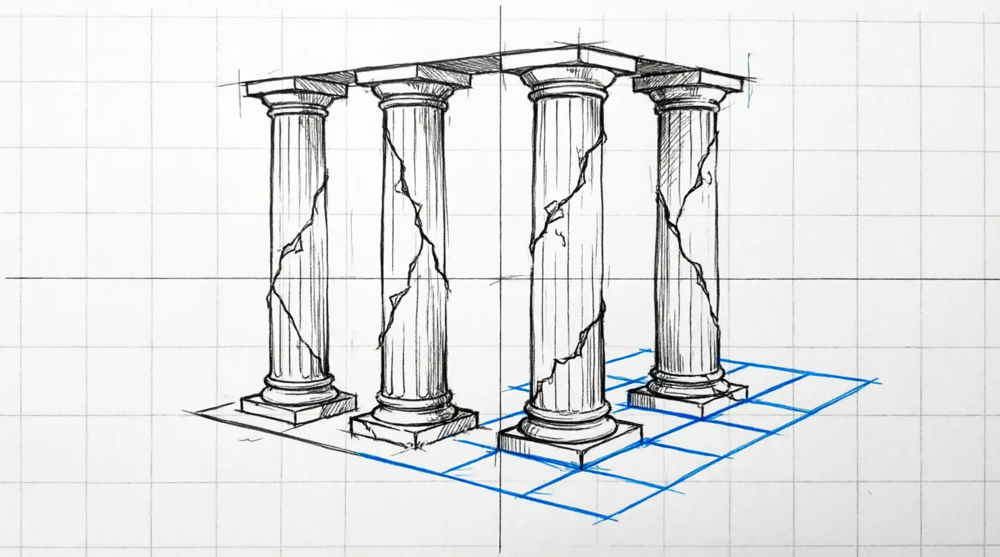
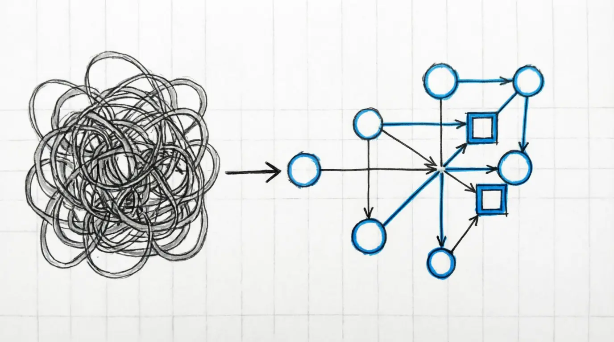

**Encapsulation.
Polymorphism.
Inheritance.
Abstraction.**

Four words you've heard at every job interview, read in every textbook, and memorized like a mantra in programming courses. Four pillars on which all object-oriented programming supposedly rests.

**But what if this isn't the foundation of OOP — but its ruins?**

What if these four principles don't explain OOP, but only confuse it? What if they're exactly what prevents us from truly understanding why this paradigm was created and how to use it properly?

## The Problem Nobody Talks About

Today, OOP is in a strange position. On one hand, it's the most widespread paradigm in the industry. On the other — **nobody can clearly explain what it actually stands on**.

In functional programming, everything is clear: the foundation is mathematics, pure functions, immutability. There's a scientific basis, there's a theory.

But what about OOP? **We're simply told: "Here are the four pillars, this is the foundation."** But how did they appear? Why these four? **What science stands behind them?** There are no answers to these questions.

As a result, we build complex systems on a shaky foundation. And the walls start cracking. You've probably seen articles criticizing inheritance, abstraction, getters, and setters. Everyone feels that **something is wrong**, but there's no constructive alternative.

What's worse, OOP has been reduced to "just a convenient way to write code." Developers confuse a paradigm with a bag of syntactic tricks. They don't understand **why** OOP was created and **what** it should be used for.

## The Revelation

My story began with building a classifieds board — my first commercial project. It was handed to me as a massive chunk of spaghetti code: several thousand lines in a single file. Back then, I thought that's just how it was supposed to be.

A couple of weeks later, I realized: something is wrong. I started looking for ways to improve the project. I tried different refactoring approaches. I started with design patterns — and for a moment, things seemed a bit better.

**But even design patterns didn't deliver what they promised**: easy maintainability and reusability.

Later came the understanding: **the problem isn't in the code, but in the very foundation of OOP**. In its four pillars, which turned out to be fragile, and it was completely unclear where they came from and why they are considered the foundation of the paradigm.

## The Promise

In this series of articles, we won't just criticize OOP. **We will reinvent it.**

We will formulate a new foundation for OOP to replace encapsulation, polymorphism, inheritance, and abstraction. A foundation that:

- **Is based on science**, not on dogma
- **Better explains OOP** as a paradigm
- **Matches the realities** of modern development

This isn't just a random set of principles. It's a **coherent system** grounded in science. Formulating these principles and a completely new theory of OOP took me more than five years.

In this series of articles, we will do the following:
- understand why OOP is needed as a paradigm
- understand why it was fundamentally wrong to separate  encapsulation, polymorphism, inheritance, and abstraction as the foundation of OOP
- identify the main principle of OOP
- understand which science should form the basis of OOP
- define the terms "object" and "object-oriented system" from scratch
- build a language from scratch that describes object interaction
- **formulate new principles of OOP instead of the four traditional pillars**
- identify four types of OOP

## Who Is This Series For

This series is **not for beginners** who are just learning syntax.

It's **for more experienced developers** who:

- Feel that something is wrong with OOP, but can't quite put their finger on what
- Are tired of bending to outdated dogmas
- Understand that OOP lacks a scientific foundation
- **Are ready to forget everything they knew about OOP and start from scratch**

But if you are a brave beginner — welcome anyway!

If you just want to learn another pattern or framework — this series isn't for you.

**But if you're ready for a paradigm shift** — welcome aboard!

## Series Map

- [x] 🚀 Part 0. Zero To One (The Blueprint)
- [ ]  Part 1. The True Essence of OOP: Black Boxes and Message Passing
- [ ]  Part 2. Objects, Components, Messages
- [ ] 🏗️ Part 3. The MOBBLOC Principles
- [ ] 🛠️ Part 4. Creating the AI-Native OOP Language From Scratch 
- [ ] 📋 Part 5. The Four Types Of OOP
- [ ] 🐹 Part 6. Choosing The Mascot For MOBBLOC Principles

**As you read this series, I urge you: completely forget everything you knew about OOP.**

Approach it with the most open mind possible. Don't try to force new ideas onto the old worldview.

Today, OOP is perceived by people as just a more convenient way to write code. But it's a **completely different paradigm** compared to functional and procedural programming.

I hope that after we reinvent OOP together, **a paradigm shift will occur**. And we will truly understand:

- Why OOP is needed
- How to use it
- When to apply it

**Step by step, we will reinvent OOP from scratch** and arrive at a new, scientifically grounded theory that will form the new foundation of object-oriented programming.