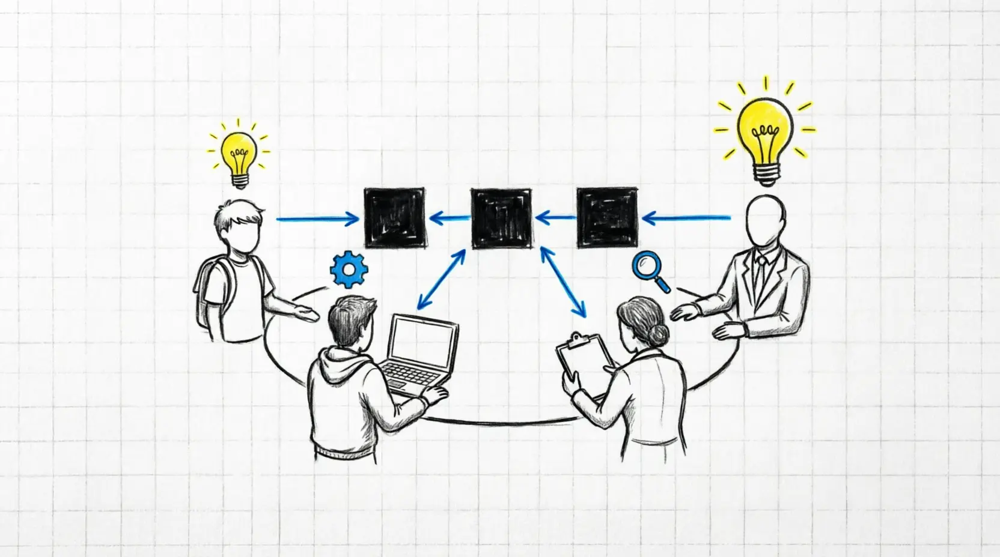

I thought for a long time about how to start this series. I could make a loud statement like, "Forget everything you learned at university." 

But let's be honest: encapsulation, polymorphism, inheritance, and abstraction are not "bad". They just aren't the most important things anymore.
<!--more-->
Especially today.

In this series, I want to offer an alternative theory for OOP. It is simpler and easier to understand. 

It throws away the extra details and leaves only two things that are older than programming itself: **black boxes** and **message passing** between them. This new theory is based on cybernetics and systems theory.

We won't just criticize old approaches (even though we have good reasons). Instead, we will build a new OOP theory step by step. 

This will help us design systems in a way that is clear not just to senior developers, but to everyone involved in making the product.

## Where the process breaks down

**Let's look at a real situation.** An analyst draws a business process diagram. 

It looks logical, and everyone is happy. Then, this diagram goes to a developer who tries to "force" it into Java, C#, or Python. 

And then the pain begins. 

Beautiful arrows turn into spaghetti code. A "simple data exchange" gets covered in complex dependencies and hidden side effects. 

By the time of release, the code architecture barely looks like the original idea. Adding a new feature feels like changing a wheel on a moving car.

The root of the problem is simple. **Classic OOP, with its four pillars, focuses us on the inside of an object**. 

We get stuck in the details and lose sight of the big picture. We think about how an object is *built*, not about how it ***communicates* with the outside world**.

Before, this was just inconvenient. 

But in the age of generative AI, when software systems are designed not just by programmers, but also by managers, analysts, and even testers, this has become the main bottleneck.

We need a new OOP theory: not just for AI, but first of all, for people. 

A theory that is clear to anyone and, more importantly, based on science.

The four "traditional" pillars of OOP do not have a scientific base.

We will fix this and formulate new principles for the foundation of OOP.

## A different point of view

The idea I am developing here is about changing our focus. 

We need a way to describe systems that does not depend on the syntax of a specific programming language.

It is all based on black boxes. That's it. 
* Are you writing a single function in C? It is a black box receiving messages.
* Are you designing business logic in Java? It is a network of interacting black boxes.
* Are you building a distributed cluster of microservices? They are the same boxes, just communicating over a network instead of through memory.

The same simple rules work everywhere. From a single line of code to a large distributed system. 

## How does AI fit into this?

With the arrival of AI, almost anyone can develop software today. We already see many games and apps created with just a few prompts. 

But when designing large business applications, a problem appears: we need to express our requests to the AI more formally. 

**Therefore, we need a stricter, yet simple, language for describing systems for non-technical people.** 

The new theory in this series will be the foundation for such a language. 

If we describe a system as a graph of black boxes with strict message rules between them, we greatly reduce the "search space" for the AI. 

This approach allows the AI to *translate* the design directly into Python, Go, or Rust code with high accuracy. 

But here is the most important part: because our design language is strict, we can write a parser or a static analyzer. 

This tool can mathematically check: does the code generated by the AI really match our original diagram? 

This is not magic. It is simply controlling changing requirements at the compilation level.

## What is next?

In the next parts, I will try to explain this clearly. Without "fluff" (or with a minimum of it).

* We will look at why classic OOP principles have run their course and are more like a random set of rules than a complete system.
* We will show the practical base of the black box approach (yes, it has a scientific basis, and I will link to it).
* We will design the syntax of our new system design language from scratch.
* We will see how this works with modern LLMs using real examples.

Does this sound ambitious? Maybe. But the principles I will talk about already work in my pet projects and daily work tasks. 

The new replacement for the four pillars of OOP is called **MOBBLOC**. 

I won't explain what it means just yet; more details will come later in this series.

Let's just try to look at familiar things from a different angle.

## Article Series Map

- [x] 🚀 Part 0. The Blueprint
- [ ] 🎯 Part 1. The True Essence of OOP: Black Boxes and Message Passing
- [ ] 🧩 Part 2. Objects, Components, Messages
- [ ] ️🧱 Part 3. The MOBBLOC Principles
- [ ] 🛠️ Part 4. Creating the AI-Native OOP Language From Scratch
- [ ] 📋 Part 5. The Four Types Of OOP
- [ ] 🐹 Part 6. Choosing The Mascot For MOBBLOC Principles
